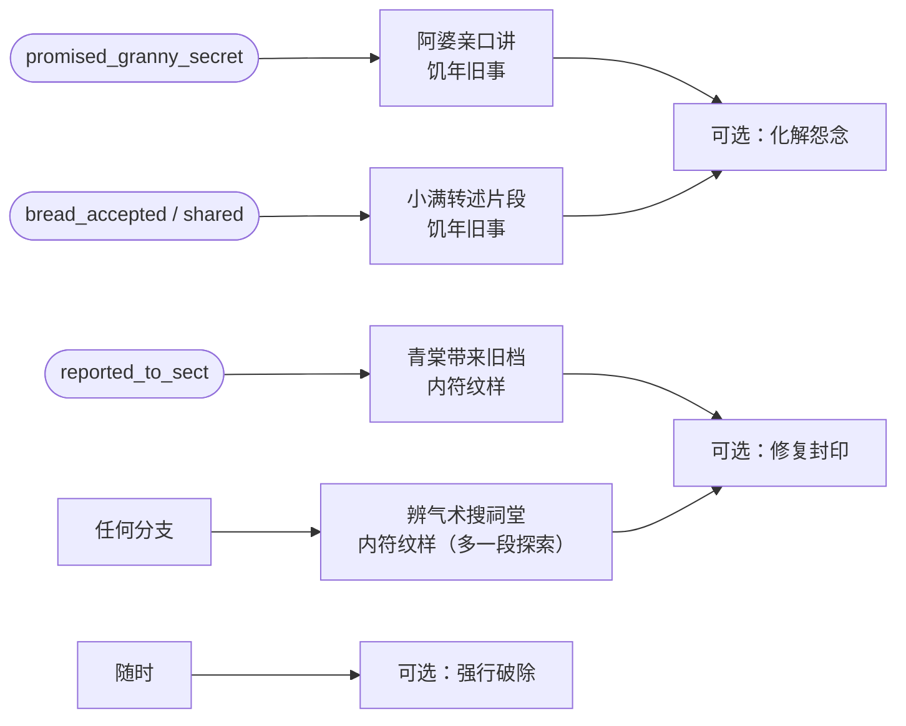

# 《归山》三次返回：事件与分支流程图

> 在 GitHub 上打开这个文件可以直接看到渲染好的图。
> 方框表示事件，菱形表示选择，圆角框表示被记录下来的事实。

## 总流程

```mermaid
flowchart TD
    P["序章·入山<br/>学会：驱邪符 / 护身符 / 明灯符"] --> V1

    subgraph V1["第一次返回 · 入门当年 · 学"]
        V1a["认识温阿婆、小满<br/>调查破损护符"] --> V1b["补符：画错一笔"]
        V1b --> V1c["挑战一：保护自己<br/>饥影藏进黑暗"]
        V1c --> V1d{"小满递麦饼"}
        V1d -->|接受 / 分着吃| F_bread(["bread_accepted / shared"])
        V1d -->|推辞| F_nobread(["bread_refused"])
        F_bread --> V1e
        F_nobread --> V1e
        V1e["青棠补笔，教定身符"] --> C1{"选择一<br/>阿婆求你守密"}
        C1 -->|答应| F_secret(["promised_granny_secret"])
        C1 -->|上报| F_report(["reported_to_sect"])
        F_secret --> V1f
        F_report --> V1f
        V1f{"回山：这一笔是你画的？"}
        V1f -->|说出是师姐| F_cred(["credited_qingtang"])
        V1f -->|默认| F_took(["took_credit"])
    end

    F_cred --> T1
    F_took --> T1
    T1["时间跳转 五年<br/>成长节点：学会辨气术、破煞符"] --> V2

    subgraph V2["第二次返回 · 五年后 · 解"]
        V2a["护符发黑，阿婆病重<br/>青棠主张强破"] --> V2b["辨气术重新调查同一场景<br/>发现：两股气息 / 铜镜连着封印"]
        V2b --> V2c["收集线索"]
        V2c --> C2{"选择二：解法"}
        C2 -->|"修复封印<br/>需要：内符纹样"| S_rep(["solution = repair"])
        C2 -->|"化解怨念<br/>需要：饥年旧事"| S_soo(["solution = soothe"])
        C2 -->|"强行破除<br/>随时可选"| S_brk(["solution = break<br/>mirror_intact = false"])
        S_rep --> V2d["挑战二：守门四回合"]
        S_soo --> V2e["挑战二：保护小满完成仪式"]
        S_brk --> V2f["挑战二：限时破屏障<br/>护镜则更慢"]
        V2d --> V2g
        V2e --> V2g
        V2f --> V2g
        V2g["阿婆去世，留下给师父的信"] --> V2h{"青棠问：你看到了什么"}
        V2h -->|如实| F_truth(["told_qingtang_truth"])
        V2h -->|隐瞒| F_hid(["hid_from_qingtang"])
    end

    F_truth --> T2
    F_hid --> T2
    T2["时间跳转 十五年<br/>师父：替我去看看她"] --> V3

    subgraph V3["第三次返回 · 二十年后 · 断"]
        V3a["小满当家，阿禾画错一笔<br/>这次由你补上"] --> V3b{"村子状态<br/>取决于 solution"}
        V3b -->|repair| V3r["门安稳，铜镜黯淡"]
        V3b -->|soothe| V3s["饥祟减弱，温晚可现身"]
        V3b -->|break| V3k["无门，田里残留饥气"]
        V3r --> V3c
        V3s --> V3c
        V3k --> V3c
        V3c["辨气深查：发现第三人的符气<br/>真相揭开"] --> C3{"选择三：终局"}
        C3 -->|继续履行旧约| E1(["ending = keep"])
        C3 -->|与当事人重新约定| E2(["ending = renew"])
        C3 -->|以自己的方式结束| E3(["ending = end"])
        E1 --> V3d["挑战三：按决定执行<br/>镇 / 迁 / 送"]
        E2 --> V3d
        E3 --> V3d
    end

    V3d --> END["尾声<br/>师父最后一幕 + 青棠评价 + 小满/阿禾的话<br/>按事实组合"]
    END --> HOOK["最后画面：第三人的符纸残片<br/>六十年前，是谁引来了饥祟？"]
```

## 线索来源（第一个选择不会封死路线）

## 尾声组合

| 终局 | 师父 | 青棠（`credited` + `truth`） | 青棠（`took_credit` 或 `hid`） | 小满 / 阿禾 |
|---|---|---|---|---|
| 旧约 | 交出竹屋钥匙，"修到你修不动为止" | "那就每年我陪你备符纸。" | "随你，别指望宗门出钱。" | 接受过麦饼：阿禾说明年还给你留饼 |
| 重约 | 迁回分支能见到温晚最后一面 | 亲自护送铜镜上山 | 只派弟子来接 | 小满一家第一次出远门 |
| 了结 | "她走了就好。" | "这次你比我狠。" | 沉默，没来送行 | 小满在门口烧了一张平安符 |
